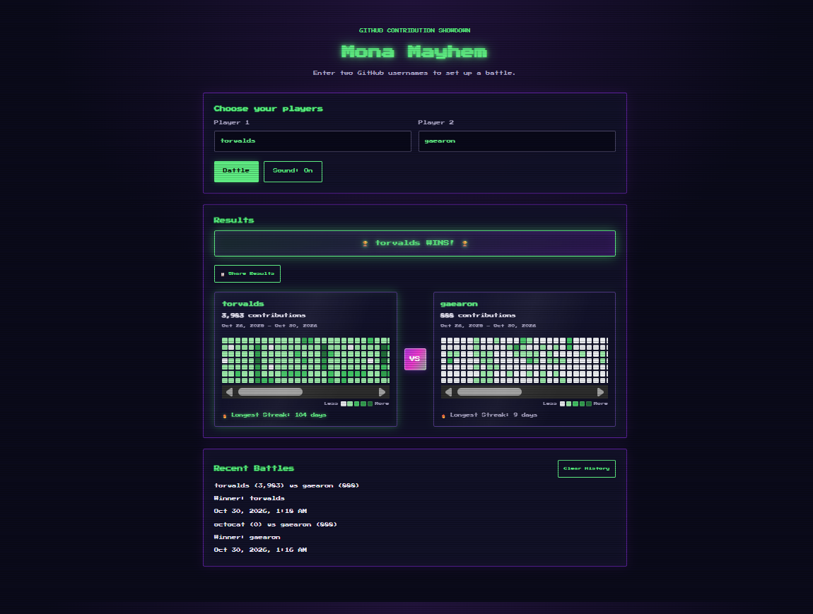

# Mona Mayhem

A retro arcade showdown for GitHub contribution graphs. Enter two GitHub usernames, watch the countdown, and find out who has been shipping more over the past year.

**[Play the live demo →](https://mona-mayhem.vercel.app)**



## Features

- **Head-to-head battles:** compare two users' contribution totals for the past year, with each player's full contribution graph and date range.
- **Winner banner:** announces the winner, or a tie, once both players' data has loaded.
- **Longest streak:** calculates each player's longest run of consecutive contribution days and highlights the longer one.
- **Battle countdown:** an animated arcade countdown runs before the results are revealed.
- **Sound effects:** coin, power-up, and explosion sounds synthesized with the Web Audio API, with a mute toggle.
- **Contribution legend:** a "Less → More" scale built from the colors GitHub returns.
- **Share results:** copies both usernames, their totals, and the outcome to the clipboard.
- **Battle history:** the 10 most recent battles are saved in the browser and can be cleared.
- **Polished details:** username validation, loading and error states, a responsive layout with scrollable graphs on small screens, screen-reader status updates, and reduced-motion support.

## Tech stack

- **[Astro 6](https://astro.build/)** in server mode, with strict TypeScript
- **Vercel** hosting: the API runs as a serverless function through [`@astrojs/vercel`](https://docs.astro.build/en/guides/integrations-guide/vercel/)
- **Node.js** standalone server through [`@astrojs/node`](https://docs.astro.build/en/guides/integrations-guide/node/) for local production builds and self-hosting
- **Browser APIs:** Web Audio, Clipboard, and `localStorage`, with no client-side framework
- **Hand-written CSS** with the Press Start 2P font from Google Fonts
- **ESLint** with typescript-eslint, eslint-plugin-astro, and @stylistic

## How it works

The page is plain HTML and CSS with a small TypeScript script. When a battle starts, the browser asks the app's own API route for each player's data, and the route fetches the user's public contribution data from GitHub (`https://github.com/<username>.contribs`) on the server.

| Method | Route | Description |
| --- | --- | --- |
| `GET` | `/api/contributions/:username` | Returns a user's contribution data as JSON. |

| Status | Meaning |
| --- | --- |
| `200` | Contribution data was found. |
| `400` | The username isn't a valid GitHub username. |
| `404` | The GitHub user doesn't exist. |
| `502` | GitHub returned an error or couldn't be reached. |
| `503` | GitHub rate-limited the request. |
| `504` | GitHub didn't respond within 8 seconds. |

Successful responses are cached in memory for 5 minutes on each server instance. If GitHub is unavailable, the last cached data can be served for up to 30 more minutes. The `X-Cache` response header shows `HIT`, `MISS`, `STALE`, or `BYPASS`.

## Run it locally

You need [Node.js](https://nodejs.org/) 22.12 or later and npm. No API keys or environment variables are required.

Clone the repository, then install the locked dependencies and start the development server:

```bash
npm ci
npm run dev
```

Open http://localhost:4321 to play.

| Command | What it does |
| --- | --- |
| `npm run dev` | Starts the development server. |
| `npm run lint` | Lints the source with ESLint. |
| `npm run build` | Builds the production server into `dist/`. |
| `npm run preview` | Serves the production build locally. |

## Deployment

The live demo runs on Vercel. [`astro.config.mjs`](astro.config.mjs) chooses the adapter at build time: Vercel sets `VERCEL=1` during its builds, so they use `@astrojs/vercel`, and every other build uses the standalone Node adapter.

- **Vercel:** import the repository. Vercel detects Astro, and no environment variables are needed. Use Node.js 22.x or 24.x in the project settings.
- **Any Node.js host:** run `npm run build`, then `node ./dist/server/entry.mjs`. Set `HOST` and `PORT` to choose where the server listens.

`@astrojs/vercel` is pinned to 10.0.8, the last release that supports Astro 6. Image optimization is turned off with Astro's passthrough image service because the app has no images to optimize, which keeps Sharp out of the server bundle.

## Project structure

```text
src/pages/index.astro                      Battle page: markup, styles, and client script
src/pages/api/contributions/[username].ts  Contribution data API route
public/favicon.svg                         Site icon
screenshots/                               README screenshot
astro.config.mjs                           Server output and adapter selection
AGENTS.md                                  Instructions for AI coding agents
.devcontainer/                             Dev container and Codespaces setup
```

## Credits

Mona Mayhem started from the [Mona Mayhem workshop template](https://github.com/copilot-dev-days/mona-mayhem) by GitHub Copilot Dev Days, a hands-on workshop for building this game with GitHub Copilot in VS Code. This version implements the full game and all seven of the workshop's bonus challenges, and adds the Vercel deployment.

## License

Released under the [MIT License](LICENSE), which keeps the copyright notice of the original workshop template.
